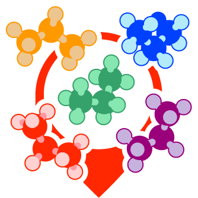
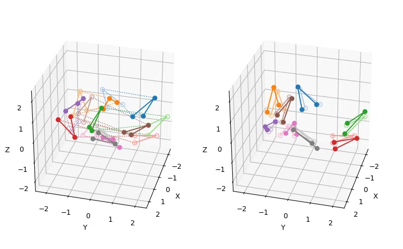

<!-- Improved compatibility of back to top link: See: https://github.com/othneildrew/Best-README-Template/pull/73 -->
<a name="readme-top"></a>

<!-- PROJECT LOGO -->
<br />

<div align="center">
  <a href="https://github.com/yymmt742/mobbrmsd">
    
  </a>

<h3 align="center">mobbrmsd</h3>

  <p align="center">
    An algorithm for efficient superposition and clustering of molecular assemblies using branch-and-bound method.
    <br />
    <a href="https://yymmt742.github.io/mobbrmsd/"><strong>Explore the docs »</strong></a>
    <br />
    <br />
    <a href="https://github.com/yymmt742/mobbrmsd/issues/new?labels=bug&template=bug-report---.md">Report Bug</a>
    ·
    <a href="https://github.com/yymmt742/mobbrmsd/issues/new?labels=enhancement&template=feature-request---.md">Request Feature</a>
  </p>
</div>


<!-- TABLE OF CONTENTS -->
<details>
  <summary>Table of Contents</summary>
  <ol>
    <li><a href="#about-the-project">About The Project</a></li>
    <li>
      <a href="#getting-started">Getting Started</a>
      <ul>
        <li><a href="#prerequisites">Prerequisites</a></li>
        <li><a href="#installation">Installation</a></li>
      </ul>
    </li>
    <li><a href="#simple-example">Simple Example</a></li>
    <li><a href="#usage">Usage</a></li>
    <li><a href="#roadmap">Roadmap</a></li>
    <li><a href="#license">License</a></li>
    <li><a href="#contributing">Contributing</a></li>
    <li><a href="#contact">Contact</a></li>
    <li><a href="#reference">Reference</a></li>
  </ol>
</details>


<!-- ABOUT THE PROJECT -->
# About The Project

[](https://github.com/yymmt742/mobbrmsd/actions/workflows/ci.yml)
[](https://yymmt742.github.io/mobbrmsd/)



Root mean squared deviation (RMSD) is one of the most common metrics
for comparing the similarity of three-dimensional chemical structures.
The molecular-oriented RMSD with branch-and-bound (mobbRMSD) is an RMSD-based
metric for 3D chemical structure similarity.

mobbRMSD is formulated in molecular-oriented coordinates and uses the
branch-and-bound method to obtain an exact solution.
It can handle large and complex chemical systems such as molecular liquids,
solvation of solute, and self-assembly of large molecules,
which are difficult to handle using conventional methods.

See [Theory](https://yymmt742.github.io/mobbrmsd/theory/) for the mathematical
definition and algorithmic details.

<p align="right">(<a href="#readme-top">back to top</a>)</p>

<!-- GETTING STARTED -->
## Getting Started

### Prerequisites

* gfortran >= 9.4.0
* OpenMP (optional)

Python interface additionally requires:
* Python >= 3.9
* pip

### Installation

```sh
pip install git+https://github.com/yymmt742/mobbrmsd.git
```

#### Windows (TDM-GCC / MinGW)

On Windows the CMake generator must be set explicitly:

```sh
set CMAKE_GENERATOR=MinGW Makefiles
pip install git+https://github.com/yymmt742/mobbrmsd.git
```

### Testing

```sh
pip install -e ".[test]"
python -m pytest tests/ -v
```

<p align="right">(<a href="#readme-top">back to top</a>)</p>

## Simple Example

The `example/` directory contains two PDB files of 7 L-alanine molecules
(13 atoms each: N, CA, C, O, OXT, CB, H1, H2, HA, HB1, HB2, HB3, HXT) in different arrangements.
`ala7_B.pdb` is a globally rotated, permuted, and slightly perturbed copy of `ala7_A.pdb`.

**CLI:**

```sh
python -m mobbrmsd run -i example/ala7.json example/ala7_A.pdb example/ala7_B.pdb
```

```
Reference frame       1 | Target    frame       1
  RMSD        :             0.576438145
  ----------
  AUTO CORR.  :         19438.744027941
  UPPER BOUND :         -9704.253231442  (as RMSD) :             0.576438145
  LOWER BOUND :         -9704.253231442  (as RMSD) :             0.576438145
  N EVAL      :                      28  (ratio)   :    0.002043944813490036
  ----------
```

mobbRMSD finds the optimal permutation + rotation in **28 evaluations out of 7! = 5040** possible
molecule assignments (0.2 % of the brute-force cost).

**Python API:**

```python
import mdtraj
from mobbrmsd.dataclass import molecular_system
from mobbrmsd.mobbrmsd import mobbrmsd

tA = mdtraj.load("example/ala7_A.pdb")
tB = mdtraj.load("example/ala7_B.pdb")
x = tA.xyz[0] * 10   # nm → Å
y = tB.xyz[0] * 10

mols = molecular_system.from_topology(tA.topology)
mrmsd = mobbrmsd(mols=mols)

result = mrmsd.run(x, y)
print(f"RMSD    = {result.rmsd():.6f} Å")
print(f"N_eval  = {result.n_eval()} / 5040  (ratio = {result.eval_ratio():.6f})")
```

```
RMSD    = 0.576445 Å
N_eval  = 28 / 5040  (ratio = 0.002044)
```

<p align="right">(<a href="#readme-top">back to top</a>)</p>

## Usage

Full documentation: **<https://yymmt742.github.io/mobbrmsd/>**

### Command-line interface

**Build a topology JSON from a coordinate file:**

```sh
python -m mobbrmsd build -f system.pdb -o topology.json
```

**Compute RMSD:**

```sh
# single pair
python -m mobbrmsd run -i topology.json reference.pdb target.pdb

# batch (multi-frame DCD/XTC)
python -m mobbrmsd run -i topology.json reference.dcd target.dcd -p topology=topology.pdb

# self-comparison (distance matrix)
python -m mobbrmsd run -i topology.json trajectory.dcd
```

**Save the fitted (rotated) target structure:**

```sh
python -m mobbrmsd run -i topology.json reference.pdb target.pdb -o fitted.pdb
```

When the reference has multiple frames, numbered output files are created
automatically (`fitted.001.pdb`, `fitted.002.pdb`, …).
Use `-O` to overwrite existing files.

**Run a demo:**

```sh
python -m mobbrmsd demo
```

### Python API

```python
from mobbrmsd.dataclass import molecules, molecular_system
from mobbrmsd.mobbrmsd import mobbrmsd

# 4 water molecules; H atoms are interchangeable
mols = molecular_system([molecules(n_apm=3, n_mol=4, sym=[[0, 2, 1]])])
mrmsd = mobbrmsd(mols=mols)

result = mrmsd.run(x, y)          # single pair → mobbrmsd_result
D = mrmsd.batch_run(frames)       # distance matrix, shape [n, n]
```

Load automatically from MDTraj:

```python
import mdtraj
from mobbrmsd.dataclass import molecular_system

traj = mdtraj.load("simulation.dcd", top="topology.pdb")
coords = traj.xyz * 10.0          # nm → Å
mols = molecular_system.from_mdtraj(traj.topology, coords)
```

<p align="right">(<a href="#readme-top">back to top</a>)</p>

## Roadmap

- [x] Python interface
- [x] MDTraj auto-detection (`from_topology`, `from_mdtraj`)
- [x] Topology builder (interactive CLI)
- [x] Variance-based species ordering
- [x] Structure output (`run -o`)
- [ ] Skip tree
- [ ] Intel compiler support
- [ ] Detailed benchmarks

See the [open issues](https://github.com/yymmt742/mobbrmsd/issues) for a full list of proposed features and known issues.

<p align="right">(<a href="#readme-top">back to top</a>)</p>

<!-- CONTRIBUTING -->
## Contributing

This project is open source and we invite contributions.
If you have a suggestion that would make this better,
please fork the repo and create a pull request.

1. Fork the Project
2. Create your Feature Branch (`git checkout -b feature/AmazingFeature`)
3. Commit your Changes (`git commit -m 'Add some AmazingFeature'`)
4. Push to the Branch (`git push origin feature/AmazingFeature`)
5. Open a Pull Request

<p align="right">(<a href="#readme-top">back to top</a>)</p>

<!-- LICENSE -->
## License

Distributed under the MIT License.
See `LICENSE.txt` for more information.

<p align="right">(<a href="#readme-top">back to top</a>)</p>

<!-- CONTACT -->
## Contact

YYMMT742 - yymmt@kuchem.kyoto-u.ac.jp

<p align="right">(<a href="#readme-top">back to top</a>)</p>

<!-- Reference -->
## Reference

Further details are available from the following publication:

* Yamamoto, Y. "Algorithm for Efficient Superposition and Clustering of Molecular Assemblies Using the Branch-and-Bound Method", _J. Chem. Inf. Model._ **2025**. <https://doi.org/10.1021/acs.jcim.4c02217>

This project is based on the following papers:

**Molecular superposition**

* Kabsch, W. A solution for the best rotation to relate two sets of vectors. _Acta Crystallogr., Sect. A_ **1976**, 32, 922–923.
* Theobald, D. L. Rapid calculation of RMSDs using a quaternion-based characteristic polynomial. _Acta Crystallogr., Sect. A_ **2005**, 61, 478–480.
* Coutsias, E. A.; Wester, M. J. RMSD and Symmetry. _J. Comput. Chem._ **2019**, 40, 1496–1508.

**Linear assignment**

* Kuhn, H. W. The Hungarian method for the assignment problem. _Naval Res. Logistics Quarterly_ **1955**, 2, 83–97.
* Munkres, J. Algorithms for the Assignment and Transportation Problems. _J. Soc. Ind. Appl. Math._ **1957**, 5, 32–38.

<p align="right">(<a href="#readme-top">back to top</a>)</p>
