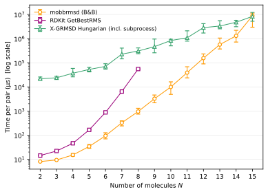
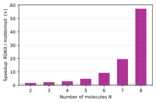
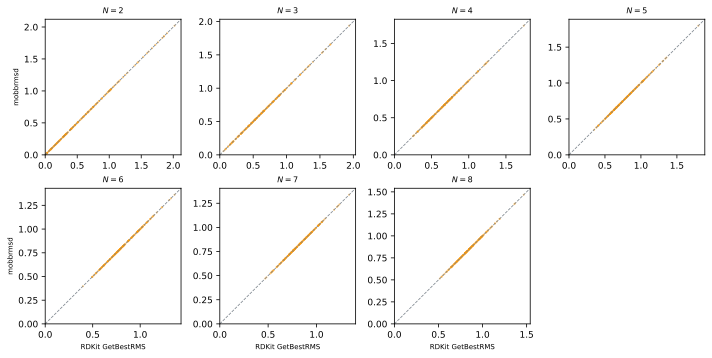
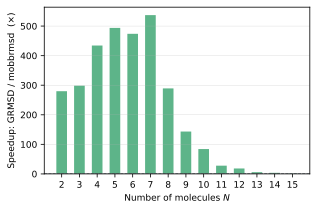
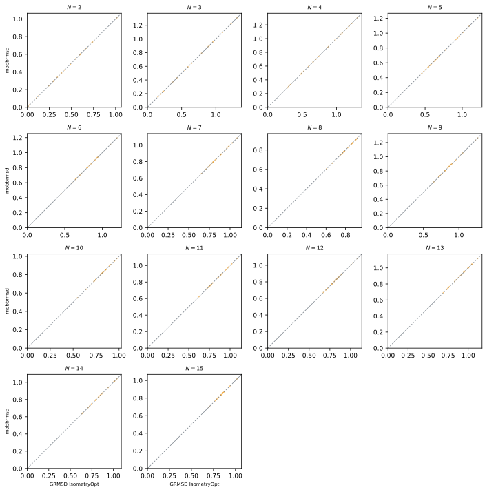

# Benchmark

Performance and accuracy comparison of `mobbrmsd` against two external tools
that solve the same problem — finding the **rotation + molecule permutation**
minimising the pairwise RMSD of *N* identical rigid molecules.

| Tool | Algorithm | Asymptotic scaling |
|------|-----------|-------------------|
| [RDKit](https://www.rdkit.org/) `AllChem.GetBestRMS` | Graph isomorphism enumeration | Exponential in *N* |
| [X-GRMSD](https://github.com/striwata/X-GRMSD) `IsometryOpt` | Hungarian assignment (Striwata, 2024) | Polynomial in *N* |
| **mobbrmsd** | Branch-and-bound (B&B) exact RMSD | Sub-factorial (aggressive pruning) |

---

## Test system

All benchmarks use the simplest non-trivial case: *N* identical point-mass
molecules (one atom each, no intramolecular symmetry) in random configurations.

| Parameter | Value |
|-----------|-------|
| `n_apm` | 1 (one atom per molecule) |
| `n_mol` | 2–8 (RDKit), 2–15 (X-GRMSD) |
| Coordinates | i.i.d. Normal(0, 1) in 3D |
| Samples | 200 pairs per *N* (RDKit), 20 pairs per *N* (X-GRMSD) |
| Timing metric | Median wall-clock time per pair (µs), IQR shown as error bars |

Choosing `n_apm = 1` maximises the combinatorial search space for a given *N*
(no intra-molecule constraints), making the scaling difference between
exponential and polynomial solvers as visible as possible.

---

## Overall timing

The chart below shows all three tools on the same axis.
The mobbrmsd line extends from *N* = 2 to *N* = 15 using the higher-precision
RDKit-run timings for *N* ≤ 8 and the GRMSD-run timings for *N* ≥ 9.



Key observations:

- **RDKit** (orange squares) grows steeply and is limited to *N* ≤ 8 before
  runtimes exceed tens of seconds per pair.
- **X-GRMSD** (green triangles) includes ~15 ms per-pair subprocess overhead,
  dominating at small *N* but growing only polynomially.
- **mobbrmsd** (blue circles) stays fast at small *N* but overtakes X-GRMSD
  around *N* = 14–15 as branch-and-bound's sub-factorial cost catches up with
  the polynomial solver.

---

## Comparison with RDKit

### Timing (N = 2 – 8)

| *N* | mobbrmsd (µs) | RDKit (µs) | Speedup |
|----:|--------------:|-----------:|--------:|
|   2 |           8.1 |       14.4 |    1.8× |
|   3 |           9.4 |       22.2 |    2.4× |
|   4 |          15.2 |       46.2 |    3.0× |
|   5 |          34.1 |      165.9 |    4.9× |
|   6 |          94.6 |      880.2 |    9.3× |
|   7 |         328.1 |    6,438.6 |   19.6× |
|   8 |         959.0 |   55,035.0 |   57.4× |

The speedup grows super-linearly because RDKit's graph-isomorphism enumeration
is exponential in *N* while mobbrmsd's branch-and-bound prunes large subtrees.



### Accuracy

Both tools return numerically identical RMSD values (max deviation < 1 × 10⁻⁶ Å
across all test pairs).



Each panel shows one value of *N*; points lie on the *y = x* diagonal, confirming
exact agreement between the two solvers.

---

## Comparison with X-GRMSD

[striwata/X-GRMSD](https://github.com/striwata/X-GRMSD) is a C++ implementation
of the Hungarian algorithm for optimal molecule assignment.  The Hungarian step
runs in **O(*N*³)** (or better with preprocessing), making the overall solver
polynomial rather than exponential.

!!! note "Subprocess overhead"
    X-GRMSD is invoked as a separate process per pair: coordinates are written
    to CSV, the binary is spawned, and its output is read back.
    Process-spawn overhead is approximately **15 ms** and dominates for small *N*.
    The reported X-GRMSD times include this overhead throughout; the actual
    algorithmic cost is much lower at small *N* but the subplot here shows the
    overhead amortisation as *N* grows.

### Timing and scaling (N = 2 – 15)

| *N* | mobbrmsd (ms) | X-GRMSD (ms, incl. subprocess) | Ratio (GRMSD/mobb) |
|----:|--------------:|--------------------------------:|--------------------:|
|   2 |          0.08 |                            21.7 |                278× |
|   3 |          0.08 |                            23.9 |                299× |
|   4 |          0.08 |                            36.9 |                434× |
|   5 |          0.11 |                            53.1 |                492× |
|   6 |          0.15 |                            70.7 |                474× |
|   7 |          0.42 |                           228.1 |                537× |
|   8 |          1.06 |                           307.4 |                289× |
|   9 |          3.25 |                           465.8 |                143× |
|  10 |          9.92 |                           833.7 |                  84× |
|  11 |         39.1  |                         1,087.7 |                  28× |
|  12 |        155.8  |                         2,858.9 |                  18× |
|  13 |        566.4  |                         3,320.5 |                 5.9× |
|  14 |      1,304.4  |                         4,764.2 |                 3.7× |
|  15 |      8,797.4  |                         8,338.8 |                 ~1× |



### Scaling analysis

The two algorithms have fundamentally different asymptotic behaviour:

- **mobbrmsd (B&B)**: worst-case *O*(*N*!) but branch-and-bound prunes most of
  the tree.  The observed growth is roughly factorial for random inputs,
  approximately ×10 every two steps in *N* at large *N*.
- **X-GRMSD (Hungarian)**: *O*(*N*³) per assignment call, polynomial overall.
  The subprocess overhead constant (~15 ms) shifts the effective crossover
  to larger *N* than a native-Python comparison would show.

**Crossover** occurs around *N* = 14–15 for random i.i.d. Normal configurations.
For structured molecular systems (tighter clustering, early pruning by the B&B
lower bound), mobbrmsd retains its advantage to larger *N*.

### Accuracy

RMSD values agree within 1 × 10⁻⁴ Å across all test pairs
(differences attributable to floating-point accumulation order in the
Hungarian step vs the B&B RMSD kernel).



---

## Reproducing these results

```bash
# Install benchmark dependencies
pip install rdkit matplotlib

# RDKit benchmark only (N=2..8, 200 samples per N)
python scripts/gen_benchmark.py

# Include X-GRMSD — build from source automatically (requires cmake + GCC/Clang)
python scripts/gen_benchmark.py --build-grmsd

# Full run: RDKit to N=8, X-GRMSD to N=15 (slow — N=15 takes ~8 s per pair)
python scripts/gen_benchmark.py \
    --n-mol-max 8 --n-samples 200 \
    --build-grmsd --grmsd-n-mol-max 15 --grmsd-n-samples 20

# Point to an already-built GRMSD binary
set GRMSD_BIN=build\grmsd\GRMSD.exe
python scripts/gen_benchmark.py
```

Alternatively, build X-GRMSD as part of the mobbrmsd cmake build:

```bash
cmake -S . -B build -DGRMSD_BENCH=ON
cmake --build build
# binary is written to build/GRMSD (or build\GRMSD.exe on Windows)
set GRMSD_BIN=build\GRMSD.exe
python scripts/gen_benchmark.py
```

The script writes SVG figures to `docs/benchmark/img/` and raw timing data to
`docs/benchmark/results.json`.

Full CLI reference:

```
usage: gen_benchmark.py [-h] [--n-samples N] [--n-mol-max M]
                        [--grmsd-bin PATH] [--build-grmsd]
                        [--grmsd-build-dir DIR]
                        [--grmsd-n-mol-max M] [--grmsd-n-samples N]
```

---

## Environment

Results above were collected on:

| | |
|--|--|
| Platform | Windows 11 (x86-64) |
| Python | 3.14 |
| mobbrmsd | development branch |
| RDKit | 2024.09.x |
| X-GRMSD | [striwata/X-GRMSD](https://github.com/striwata/X-GRMSD) `main` |
| Compiler (X-GRMSD) | TDM-GCC 10.3.0 (MinGW-w64) |
